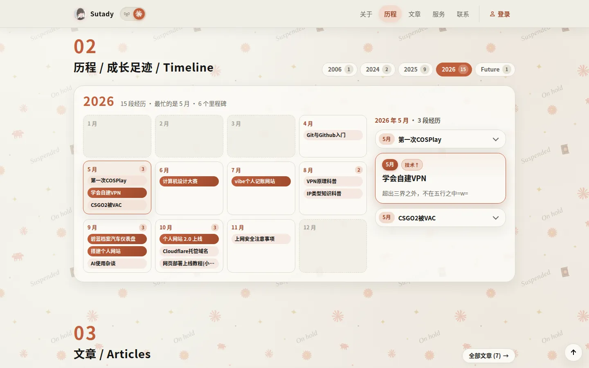

<div align="center">


# Sutady 的小屋

*Study makes perfect, what Sutady wants to be.*

个人网站与技术博客

[](https://sutady.top)
[](./CHANGELOG.md)
[](./LICENSE)
[](https://astro.build)
[](https://pages.cloudflare.com)

</div>

<table>
  <tr>
    <td width="78%" align="center"><br /><sub>首页</sub></td>
    <td width="22%" align="center"><br /><sub>手机端</sub></td>
  </tr>
</table>
<table>
  <tr>
    <td width="50%" align="center"><br /><sub>年历式成长时间线</sub></td>
    <td width="50%" align="center"><br /><sub>文章页：切换侧栏、目录、浏览量</sub></td>
  </tr>
</table>
<table>
  <tr>
    <td align="center"><br /><sub>两套主题：Claude（默认，左）和粉色马卡龙（右），顶栏开关一键切换</sub></td>
  </tr>
</table>

---

## ✨ 特色

| 功能 | 说明 |
| :--- | :--- |
| 🎨 **可切换的主题** | Claude（默认，Claude 娘同人致敬：陶土橙 + 墨黑 + 纸张底色）和粉色马卡龙两套外观，顶栏开关一键切换，新主题像斜向幕布一样推过去，方向跟着开关滑块走，中途再点会原路退回；每套主题有自己的配色、插画和背景小图案，排版共用；只下载当前主题的插画 |
| ⏳ **年历式时间线** | 电脑端按年份翻页，每年一张 12 个月的格子，点月份看当月经历（经历多的月份折叠成一行行标题，点开看详情）；手机端按年份折叠，只显示最近几条；节点可以关联文章，两边互相跳转 |
| 📖 **舒服的阅读体验** | 导语、阅读时长、阅读进度条、目录跟随、文章切换侧栏、图片点击放大、上一篇 / 下一篇 |
| 🎬 **细腻的动效** | 首屏依次浮现、卡片错落出场、换页翻书、从卡片展开成文章；所有展开 / 收起都有过渡；尊重系统的“减少动态效果”设置 |
| 👀 **浏览量** | 文章卡片和文章页显示阅读次数，同一访客一天只算一次 |
| 📊 **访问统计** | 站长在“我的账号”里看每天的访客数和浏览次数（汇总 + 最近 30 天柱状图），只有站长能看到 |
| 💬 **账号与评论** | 用户名 + 密码注册，评论支持楼中楼、编辑、删除；站长评论带“站长”标签 |
| 🔔 **回复提醒** | 有人回复你时，头像上出现小红点；“我的账号”里查看回复、修改密码、注销账号 |
| 📡 **订阅与分享** | RSS 订阅、站点地图；链接发到 Telegram / X 时带预览卡片 |
| 📱 **手机端适配** | 固定顶栏 + 一体化下拉菜单、折叠目录、回到顶部 |

## 🧱 技术栈

- **页面**：[Astro 7](https://astro.build) 纯静态生成，不用 React / Vue 等前端框架；交互全部由原生 TypeScript 完成
- **样式**：原生 CSS + CSS 变量，没有 UI 库
- **接口**：[Cloudflare Pages Functions](https://developers.cloudflare.com/pages/functions/)，部署在同域 `/api/...`
- **数据库**：[Cloudflare D1](https://developers.cloudflare.com/d1/)（SQLite），存浏览量、访问统计、账号和评论
- **安全**：密码加盐哈希、HttpOnly 会话、按 IP 限流、同源校验、CSP 等安全响应头
- **部署**：推送到 `main` 后 Cloudflare Pages 自动构建上线，不需要服务器

<details>
<summary><b>🗂️ 项目结构</b></summary>

```text
PersonalWeb/
├── content/              # ✏️ 网站内容：改这里就能更新网站
│   ├── site.json         #    昵称、标语、默认主题等全局信息
│   ├── social.json       #    联系方式
│   ├── about.md          #    关于我
│   ├── articles/         #    文章
│   ├── timeline/         #    时间线经历
│   └── services/         #    服务卡片
├── public/images/        # 🖼️ 图片素材（themes/<主题名>/ 是各主题的插画和底纹）
├── src/
│   ├── components/       #    页面各区块（Hero、Timeline、Comments…）
│   ├── layouts/          #    BaseLayout：所有页面共用的外框（顶栏、页脚、主题、分享信息）
│   ├── pages/            #    首页、文章页、登录页、账号页、404、RSS、sitemap
│   ├── scripts/          #    前端交互：ui.ts 是入口，core/ 是通用工具，features/ 每个文件一块功能
│   ├── styles/           #    样式：global.css 按顺序导入 base/、themes/（每套主题的配色）、components/、sections/、pages/
│   └── lib/              #    站点信息、主题清单（themes.ts）、文章列表，以及构建时的图片检查与图片属性插件
├── functions/            # ⚙️ 后端接口（浏览量、访问统计、账号、评论、回复提醒）
├── migrations/           # 🗄️ 数据库表结构
└── scripts/              # 👑 admin.mjs 站长管理命令、smoke.mjs 接口冒烟测试
```

</details>

<details>
<summary><b>📝 更新内容</b></summary>

日常只需要改 `content/` 里的文件，推送后网站自动更新。

| 想改什么 | 改哪个文件 |
| :--- | :--- |
| 昵称、标语、简介 | `content/site.json` |
| 默认主题 | `content/site.json` 的 `defaultTheme`（`claude` 或 `macaron`） |
| 主题插画、配色 | 插画在 `public/images/themes/<主题名>/`（登记在 `src/lib/themes.ts`），配色在 `src/styles/themes/<主题名>.css`，详见 MAINTENANCE.md 1.6、1.7 |
| 关于我 | `content/about.md` |
| 发新文章 | 在 `content/articles/` 新建 `.md`，必填 `title`、`date`、`description`；`category` 不写时默认是“教程” |
| 时间线经历 | `content/timeline/*.md`，日期写成 `"年.月.日"`（记不清哪天就写 `"年.月"`），年月决定它落在年历的哪个月；写 `article: 文章文件名` 可以关联文章 |
| 服务卡片 | `content/services/*.md` |
| 联系方式 | `content/social.json`，可以是跳转链接（`link`）或点击复制（`copy`） |
| 图片 | 放进 `public/images/`，文件名全小写，Markdown 里用 `/images/...` 引用 |

> 💡 发文规范、插图防 404、发布前检查清单都在 [MAINTENANCE.md](./MAINTENANCE.md)。

</details>

<details>
<summary><b>🛠️ 本地运行</b></summary>

需要 [Node.js](https://nodejs.org/) 22.23.4 或更高版本。

```bash
npm install        # 安装依赖
npm run dev        # 开发预览 → http://localhost:4321（只有静态页）
```

| 命令 | 作用 |
| :--- | :--- |
| `npm run check` | 类型检查，需要 0 errors |
| `npm run build` | 打包到 `dist/`，上线前必须通过（会自动检查图片路径） |
| `npm run smoke` | 接口冒烟测试：在临时数据库上自动走一遍浏览量、访问统计、注册、评论、回复提醒、改密码、注销等流程 |
| `npm run preview` | 预览打包结果（只有静态页） |
| `npm run preview:full` | 完整预览，含浏览量、访问统计、登录、评论 → http://localhost:8911<br />第一次运行前、以及 `migrations/` 里新增了文件时，先建 / 补本地表：`npx wrangler d1 migrations apply sutady-db --local` |
| `npm run db:migrate` | 把新的数据库表结构应用到线上 |
| `npm run admin -- users` | 站长管理：查看用户、重置密码、设站长，详见 [ADMIN_GUIDE.md](./ADMIN_GUIDE.md) |

</details>

<details>
<summary><b>🚀 部署</b></summary>

项目已接入 Cloudflare Pages，**推送到 `main` 就是上线**：

1. Cloudflare 自动运行 `npm run build`，一两分钟后 [sutady.top](https://sutady.top) 更新；
2. `functions/` 自动部署为 `/api/...` 接口，数据库绑定写在 `wrangler.toml`（D1 数据库 `sutady-db`，绑定名 `DB`）；
3. 数据库结构有变化时，另外运行 `npm run db:migrate`。

Cloudflare Pages 构建设置：

| 设置项 | 值 |
| :--- | :--- |
| Framework preset | `Astro` |
| Build command | `npm run build` |
| Build output directory | `dist` |
| Production branch | `main` |

</details>

## 📚 文档

| 文档 | 写给谁 | 内容 |
| :--- | :--- | :--- |
| [MAINTENANCE.md](./MAINTENANCE.md) | 站长 | 发文流程、插图规范、时间线和服务卡片维护、发布前检查、待办事项 |
| [ADMIN_GUIDE.md](./ADMIN_GUIDE.md) | 站长 | 零基础手册：看访问统计、查看用户、重置密码、设站长、删评论、在 Cloudflare 后台看数据 |
| [CHANGELOG.md](./CHANGELOG.md) | 所有人 | 每个正式版本更新了什么 |
| [AGENTS.md](./AGENTS.md) | AI 助手 | 所有 AI 共用的开发守则：设计变量、手机端红线、安全规则 |
| [CLAUDE.md](./CLAUDE.md) | AI 助手 | 代码架构速览和常用命令 |

---

<div align="center">

代码基于 [MIT 协议](./LICENSE) 开源 · 文章、图片等内容 © 2026 Sutady，保留所有权利

</div>
